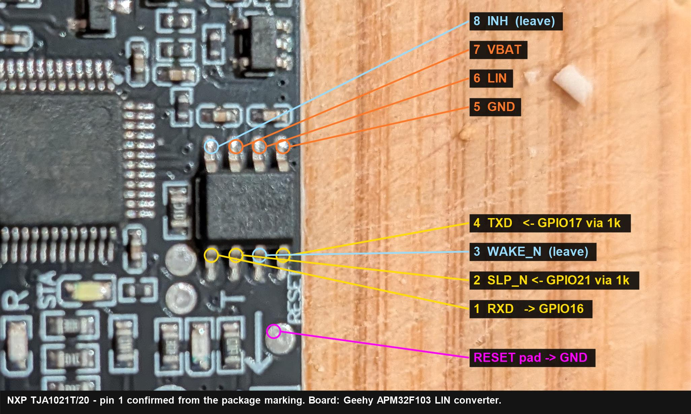

# Hardware

## Why not a CAN transceiver

The P38A (1995–2002) has no CAN bus. Land Rover's first CAN vehicle was the
L322 in 2002. On the P38 the modules talk to each other over a proprietary
clocked serial data bus (ground, clock, data, direction — each wire
duplicated for redundancy), and they talk to *diagnostic tools* over a
single-wire ISO 9141 K-line at 10400 baud.

An SN65HVD230 or any other CAN transceiver has nothing to connect to here.

## The diagnostic socket

16-pin J1962 connector, under the dash on the driver's side.

| Pin | Wire colour       | Function |
|-----|-------------------|----------|
| 7   | Pink/Red          | **K-line** — main diagnostic line: BeCM, HEVAC, ABS, engine ECU, gearbox ECU |
| 15  | Light Green/Red   | L-line — also used in ABS / HEVAC / BeCM comms |
| 4,5 | Black             | Ground |
| 16  | —                 | Battery +12V (permanent) |

Verify against a P38 wiring diagram for your exact car before cutting
anything. EAS diagnostic lines route through the LH footwell kick panel
connectors, which are notorious for corroding — if EAS is the only module
that will not answer, look there before suspecting your circuit.

## Reference circuit — L9637D

The L9637D is a purpose-built ISO 9141 K-line transceiver. Minimal circuit:

```
                       +12V (pin 16, fused 1A)
                            |
                            +--[510R]--+
                            |          |
   ESP32                 +--+--+       |
   GPIO17 (TX) --------> | Vs  |       |
   GPIO16 (RX) <-------- | RX  K |-----+-----> pin 7  (K-line)
   3V3        ---------> | Vcc   |
   GND        ---------> | GND L |-----------> pin 15 (L-line, optional)
                         +-------+
                            |
                           GND (pins 4/5)
```

- 100nF decoupling on Vcc and Vs.
- The 510R pull-up from K to +12V is required; some modules are marginal
  without it even though the L9637D has an internal pull-up.
- Do **not** power the ESP32 from pin 16 directly. Use a proper 12V→5V buck
  converter; automotive rails carry transients that will kill a bare LDO.
- Add a common ground between the ESP32 and the car before connecting K.

## Reference circuit — TJA1021 (bare chip)

The module actually bought has a microcontroller in front of the
transceiver — see [the module in hand](#the-module-in-hand--u7x54911-ttl-to-lin-bus-tja1021-module)
below for how to get at the chip directly.

NXP list "K-line compatible" as a feature of the TJA1021. It has no logic
supply pin: RXD is open-drain, so **the rail you pull RXD up to is the logic
level**. Pull it to 3.3 V and the ESP32 sees 3.3 V, with no divider needed.

```
                       +12V (pin 16, fused 1A)
                            |
                            +--[510R]--+          3V3
                            |          |           |
   ESP32                 +--+--+       |         [4k7]
   GPIO16 (RX) <---------| RXD  |      |           |
   GPIO21 (EN) --------->| SLP_N|      |           |
              +12V ----->| WAKE_N   LIN|-----+-----> pin 7  (K-line)
   GPIO17 (TX) --------->| TXD  |      |
   GND        ---------->| GND  |   VBAT|<---------- +12V
                         |      |    INH|--- (n/c)
                         +------+
```

- **RXD (pin 1) is open-drain — it needs that 4k7 pull-up to 3.3 V.**
  If the module already fits one, check what rail it goes to. A pull-up to
  an onboard 5 V rail puts 5 V on an ESP32 pin rated 3.6 V absolute maximum;
  lift it and re-pull to 3.3 V. This is the one way this board can damage
  the ESP32.
- **SLP_N (pin 2) must be driven high** — internal 140–1200 kΩ pull-down,
  and Normal mode is entered on the *rising edge*. That is
  `CONFIG_RRP38_EN_GPIO`. `V_IH` is 2 V, so 3.3 V is fine. If the module
  straps it high already, set the config to `-1`.
- **WAKE_N (pin 3) to +12V.** Its internal pull-up is only 1–30 µA; left
  floating, noise can fake a local wake-up.
- The firmware brings SLP_N high *after* the UART owns the TX pin, which
  matters: entering Normal mode with TXD low leaves the transmitter off.
- **INH (pin 8)** is an inhibit output that goes high in Normal mode. Not
  used here; NXP's own master-mode suggestion is a resistor and series diode
  from INH (or VBAT) to LIN, which is what the 510R does.
- Internal responder termination is 20/30/47 kΩ to VBAT — far too weak for
  K-line. The external 510R is still required.
- VBAT survives −0.3 to +40 V, but transmission is only guaranteed to 18 V.
  A TVS is still worth fitting; it is no longer life-or-death for the part.
- **Slow init needs the bypass MOSFET below. Fast init does not** — see
  the TXD timeout note.

## The module in hand — U7X54911 "TTL to LIN Bus TJA1021 Module"

Received and inspected 2026-09-30. **It is not a bare transceiver
breakout.** It has a microcontroller between its screw terminals and the
TJA1021, so the ESP32 cannot reach the transceiver through the terminals.

| Part | Identification |
|------|----------------|
| SO8 transceiver | **NXP TJA1021T/20** — marking *NXP / 1021T/20 / HNNRBA / B321*. Genuine, 20 kBd slope variant; fine at 10400 |
| LQFP48 MCU | **Geehy APM32F103C8T6** — an STM32F103C8T6 clone, 3.3 V |
| SOT-223 | 3.3 V LDO for the MCU, fed from the 12 V terminal |
| Header | `3V3 / TX / RX / GND` plus a `RESET` pad — the MCU's programming port |
| Terminals | `VCC(12V) / LIN / GND` on the bus side; `RX / TX / GND` on the logic side |

The seller calls it an *"intelligent protocol converter"* supporting *"host
request control frame and host request status frame"* — i.e. a LIN master
that generates break, sync, PID and checksum itself. It cannot hold the bus
low for 25 ms (fast init) or 200 ms (slow init), will likely discard K-line
traffic that has no LIN break, and no raw or transparent mode is documented.
**Used as designed, it cannot do this job.**

**Do not connect it to the car with the MCU running.** A LIN master may
transmit on its own at power-up, and neither of the firmware's TX gates can
stop it.

### Bypass the MCU

Hold the MCU in reset and wire the ESP32 straight to the TJA1021's legs.
In reset the APM32 (like the STM32) puts every GPIO into floating input, so
it lets go of TXD and SLP_N.



| ESP32 | Goes to | Note |
|-------|---------|------|
| GND | `RESET` pad | Holds the MCU in reset |
| GPIO17 (TX) | TJA1021 pin 4 TXD | **Through 1 kΩ** |
| GPIO21 (EN) | TJA1021 pin 2 SLP_N | **Through 1 kΩ** |
| GPIO16 (RX) | TJA1021 pin 1 RXD | Direct |
| GND | `GND` terminal | Common ground |
| — | `VCC` terminal | +12 V, fused |
| — | `LIN` terminal | K-line; bypass MOSFET drain also goes here |

- The logic-side `RX` / `TX` screw terminals are left unconnected.
- **The 1 kΩ resistors are there in case the reset wire comes off.** If the
  MCU wakes up and drives the same pins, the two fight through a resistor
  rather than directly. 1 kΩ against the TJA1021's 140 kΩ minimum pull-down
  costs nothing.
- Pins 3, 5, 6, 7 and 8 are already wired by the board. Leave them alone.
- Solder thin wire onto the shoulder of each leg; the pitch is 1.27 mm.
- **Pin 1 location is confirmed** from the package marking: read upright,
  pin 1 is bottom-left. On the board that is the end of the `RESET`-side
  row farthest from the board edge.

`sdkconfig.ncv.defaults` applies unchanged.

### Still to measure (board unpowered)

- **Pin 5 to the `GND` terminal** — continuity. A ten-second sanity check
  before soldering.
- **Pin 1 RXD to the `3V3` header pin** — expect a few kΩ. The board runs
  its logic at 3.3 V, so this pull-up cannot put 5 V on the ESP32. If it
  reads open or above ~100 kΩ, the board may have relied on the MCU's
  internal pull-up, which is gone in reset — fit 4.7 kΩ from RXD to 3.3 V.
- **`LIN` to `VCC` terminal** — the master pull-up, if any.
  **Measured ~10 MΩ (2026-09-30), which is inconclusive:** a master
  pull-up normally has a series diode, and probably so does the board's
  `VCC` input, so an ohmmeter cannot see through it. Use the powered test
  below instead.

### Master pull-up — powered test (bench only)

12 V on `VCC` / `GND`, nothing else on `LIN`, ESP32 not connected. The MCU
will run; on the bench that is harmless.

1. Measure `LIN` to `GND` — expect ~10–11 V, the bus resting high.
2. Put a **1 kΩ from `LIN` to `GND`** and measure again:

| LIN under 1 kΩ load | Meaning | Action |
|---------------------|---------|--------|
| ~5 V | 1 kΩ master pull-up fitted | Add **1 kΩ** 12 V→LIN in parallel → ~500 Ω |
| < 1 V | Only the chip's 30 kΩ termination, or nothing | Fit the full **510 Ω** |
| ~2–3 V | Something like 2.2–4.7 kΩ | Work out the parallel value for ~500 Ω total |

Don't simply add 510 Ω without knowing: on top of a hidden 1 kΩ that makes
~340 Ω, which at 14.4 V draws ~42 mA — past the TJA1021's 40 mA minimum
current limit, so the driver could fail to pull the bus fully low.

### Connection reference — every wire, and why

```
 CAR DIAGNOSTIC SOCKET        TJA1021 MODULE                        ESP32
 ─────────────────────        ──────────────                        ─────
 pin 16 +12V ──fuse──┬──────► VCC terminal ──► TJA pin 7 VBAT
                     ├─[510Ω]─┐
                     └──────► buck 12→5V ─────────────────────────► 5V / VIN
 pin 7  K-line ──────────────┴► LIN terminal ◄─► TJA pin 6 LIN
                                   ▲
                                   └── MOSFET drain (slow init only)
 pin 4/5 GND ────────────────► GND terminal ◄─► TJA pin 5 GND ◄──► GND
                                               TJA pin 1 RXD ─────► GPIO16
                                               TJA pin 2 SLP_N ◄─[1k]─ GPIO21
                                               TJA pin 4 TXD  ◄─[1k]─ GPIO17
                                               RESET pad ◄────────── GND
                              MOSFET gate ◄─[1k]─ GPIO22   (100k gate→GND)
```

#### Car side — diagnostic socket

| Pin | What it is | Connects to | Why |
|-----|-----------|-------------|-----|
| **16** | Permanent battery +12 V | 1 A fuse → module `VCC`, the 510 Ω pull-up, and the ESP32's buck converter | Powers everything. The fuse protects the car's wiring; a TVS clamps transients |
| **4 / 5** | Chassis / signal ground | Module `GND` and ESP32 GND | One common ground — without it "high" and "low" mean nothing between car and ESP32 |
| **7** | K-line, the diagnostic bus | Module `LIN` terminal | The single wire BeCM, GEMS, ABS, HEVAC and gearbox all talk on |
| **15** | L-line | Not connected | Only used by some old init schemes; most ECUs accept K-only |

#### Module terminals

| Terminal | Connects to | Notes |
|----------|-------------|-------|
| `VCC` (12V) | Fused +12 V | Feeds TJA1021 VBAT and the board's 3.3 V LDO, probably via a reverse-polarity diode |
| `LIN` | Car pin 7, the 510 Ω pull-up, the MOSFET drain | This *is* the K-line |
| `GND` | Car ground and ESP32 GND | Common ground |
| `RX` / `TX` (logic side) | **Nothing** | They go to the MCU, which is bypassed |
| `3V3/TX/RX/GND` header | **Nothing** — 3V3 is used only as a probe point for the RXD pull-up measurement | The MCU's programming port |
| `RESET` pad | **ESP32 GND** | Holds the MCU in reset: its pins float and it cannot transmit |

#### TJA1021 pins

**Pin 7 — VBAT: the chip's supply.**

- Already wired by the board to the `VCC` terminal, which is fed from car
  pin 16. Nothing to solder here.
- Powers the chip's bus driver and receiver. It draws a few mA; it does
  **not** power the ESP32.
- **It defines the bus "high".** Inside the chip, 30 kΩ plus a diode pull
  LIN up towards VBAT, so an idle bus sits at about battery voltage.
- **It sets the receiver thresholds.** The receiver decides low or high as
  a fraction of VBAT, roughly 40 % and 60 %. That is why VBAT must come
  from the **same battery** the car's ECUs use. A separate 12 V would put
  the chip and the ECUs in disagreement about where "high" is. On the
  bench, one supply feeds both.
- Works from 5.5 to 27 V and survives up to 40 V. Transmission is only
  guaranteed to 18 V, which is why a TVS is still worth fitting.

**Pin 6 — LIN: the bus pin.** Already wired to the `LIN` terminal.

- To send a low, the driver pulls the line to about 1 V. To send a high,
  it lets go, and the pull-ups bring the line back to 12 V.
- The internal 30 kΩ pull-up is far too weak for K-line, so the external
  **510 Ω from +12 V to LIN** is required. It is the ISO 9141 master
  pull-up and gives sharp edges at 10400 baud.
- About 24 mA flows when the line is low, well inside the driver's
  40–100 mA limit.

**Pin 5 — GND.** Already on the board ground.

**Pin 4 — TXD: data in from the ESP32.**

- Connect ESP32 **GPIO17** (UART TX) through **1 kΩ**.
- TXD low drives the bus low; TXD high releases it. The UART idles high,
  so the bus rests high.
- The 1 kΩ protects against contention if the MCU ever wakes up.
- The chip cuts the driver after 27–90 ms of continuous low. That is fine
  for normal bytes (under 1 ms) and fast init (25 ms), but too short for
  slow init's 200 ms bits — hence the MOSFET.

**Pin 1 — RXD: data out to the ESP32.**

- Connect ESP32 **GPIO16** (UART RX) directly.
- Mirrors the bus state. The output can only pull low, so a pull-up to
  3.3 V makes the high level (measurement #2 above; fit 4.7 kΩ to 3.3 V if
  it reads open).
- Every byte you send comes straight back on RXD, because the bus is
  shared in both directions. The firmware checks that echo on every byte,
  which doubles as a continuous wiring test.

**Pin 2 — SLP_N: on/off.**

- Connect ESP32 **GPIO21** through **1 kΩ**.
- Low is sleep, with the bus disconnected. The rising edge switches the
  chip on. An internal pull-down keeps it asleep if nothing drives it.
- The firmware raises it only after the UART is holding TXD high: entering
  normal mode with TXD low would leave the transmitter off.

**Pin 3 — WAKE_N: local wake input.** Wired by the board. Leave it alone.

**Pin 8 — INH: inhibit output.** Rises to near battery voltage while the
chip is active; meant for switching on an external regulator. Unused here.
Leave it alone.

#### ESP32 side

| ESP32 | To | Purpose |
|-------|----|---------|
| **GPIO17** | TJA pin 4 via 1 kΩ | UART TX, 10400 baud |
| **GPIO16** | TJA pin 1 | UART RX, including the echo |
| **GPIO21** | TJA pin 2 via 1 kΩ | Transceiver on/off (`CONFIG_RRP38_EN_GPIO`) |
| **GPIO22** | MOSFET gate via 1 kΩ | Slow init only (`CONFIG_RRP38_INIT_DRIVER_GPIO`) |
| **GND** | Module GND and the `RESET` pad | Common ground; MCU held off |
| **5V / VIN** | Buck converter output, or USB on the bench | ESP32 power. **Not** the module's 3V3 — its small LDO is not meant for that. Never run the ESP32 straight off the car's 12 V |

#### Bypass MOSFET — slow init only

| Part | Connection | Why |
|------|-----------|-----|
| 2N7002 / BSS138 **drain** | `LIN` terminal | Pulls the K-line low. It has no timeout, unlike the TJA1021 |
| **Source** | GND | |
| **Gate** | GPIO22 via 1 kΩ, plus **100 kΩ to GND** | The 100 kΩ keeps the MOSFET off while the ESP32 boots or resets. Without it, a floating gate could hold the car's bus low |

During a 5-baud init TXD stays high, so the chip is not transmitting, and
the MOSFET creates the low bits instead. The chip's RXD still sees them.
Details in [Bypass MOSFET](#bypass-mosfet--for-transceivers-with-a-txd-dominant-timeout).

#### How one bit flows

1. The ESP32 sends a 0 bit, so GPIO17 goes low.
2. TJA1021 TXD goes low, and its LIN pin pulls pin 7 down to about 1 V.
3. Every module on the bus sees it, and so does the TJA1021's own
   receiver.
4. RXD goes low, so GPIO16 reads the echo.

For a 1 bit, GPIO17 goes high, the driver lets go, the 510 Ω pulls the line
back to 12 V, and RXD reads 3.3 V.

#### On the bench

- One 12 V bench supply stands in for the car: it feeds `VCC` and the
  510 Ω pull-up to `LIN`.
- Nothing else on `LIN`.
- The ESP32 runs from USB.
- **Connect the bench supply's GND to the ESP32's GND.** On the bench
  nothing else ties them together.


## Bypass MOSFET — for transceivers with a TxD dominant timeout

Needed when the transceiver releases the bus if TxD is held low too long.
The onsemi NCV7329 does this after 14–46 ms and the NXP TJA1021 after
27–90 ms, against a 200 ms bit cell in a 5-baud init. See
[INTERFACE-MODULES.md](INTERFACE-MODULES.md) for which parts are affected.

On the TJA1021 this is only needed for **slow init** — its 27 ms guaranteed
minimum is longer than the 25 ms low of a fast init, so fast init goes
through the transceiver normally.

The fix is to drive the init bits through an external MOSFET that the
transceiver's timer knows nothing about, and hold TxD recessive meanwhile.
Normal byte traffic is short enough to go through the transceiver as usual.

```
                                    K-line (socket pin 7)
                                          |
                                          |
   ESP32 GPIO22 ──[1k]──┐              ┌──┘
   (init driver)        │            D │
                        ├──── gate ────┤  2N7002 / BSS138
                      [100k]           │  (N-channel, Vds >= 60V)
                        │            S │
                       GND            GND
```

- **2N7002** (60 V, 115 mA) or **BSS138** (50 V, 200 mA). Either is ample —
  pulling the K-line low through a 510 Ω pull-up to 12 V draws about 24 mA.
- The 1 kΩ series gate resistor limits inrush; the 100 kΩ pull-down keeps
  the MOSFET off while the ESP32 is in reset. **Do not omit the pull-down** —
  a floating gate during boot can hold the car's diagnostic line dominant.
- Logic is active-high: GPIO high turns the MOSFET on and pulls the bus
  dominant. The firmware handles the inversion.

Enable with:

```
CONFIG_RRP38_INIT_DRIVER_GPIO=22    # gate
CONFIG_RRP38_EN_GPIO=21             # transceiver EN, if it has one
```

With `CONFIG_RRP38_INIT_DRIVER_GPIO` set, the firmware leaves the UART
attached to the TX pin throughout (idle high = recessive) and bit-bangs the
init through the MOSFET instead, so the two drivers never fight.

## Sourcing — what to buy

Ranked by how little work is left for you.

### 1. LIN transceiver breakout — easiest to actually buy

LIN is electrically almost identical to K-line: single wire, 12V,
open-drain, pull-up. NXP's own TJA1020 application note states the part
supports K-line, and that its pinout was deliberately chosen to be
compatible with standard K-line transceivers.

- **MCP2003 / MCP2004** breakout boards — widely stocked, e.g. Copperhill
  Technologies' LIN Bus Breakout Board (MCP2004A).
- **TJA1020 / TJA1021** modules — common on eBay/AliExpress, often sold as
  "LIN bus module" or "LIN slave node board".

Search terms: `LIN bus breakout board`, `MCP2004 LIN module`,
`TJA1020 LIN transceiver board`.

Caveats: LIN transceivers are wave-shaped for 20 kbaud max — fine at 10.4k.
Check whether the board has a TXD dominant timeout (it will force the bus
recessive if you hold it low too long; irrelevant for normal framing) and
whether it needs an enable/SLP pin driven high. Budget one extra GPIO.

### 2. Gut a KKL 409.1 cable — cheapest, ~€5–10

A "KKL VAG-COM 409.1" cable is a USB-serial chip plus a K-line transceiver
in a plug. Buy one, open it, and wire your ESP32 UART straight to the
transceiver's logic-side TX/RX pins, bypassing the USB chip entirely. You
get the OBD connector, the 12V pickup and the transceiver for the price of
a coffee.

Buy the **FTDI FT232RL** version, not a CH340 clone — the FTDI ones are
better built, and if the transceiver turns out to be unusable you still have
a working cable. Search: `KKL 409.1 FTDI FT232RL`.

Downside: you have to identify the transceiver on the board yourself. Common
ones are the L9637D, a discrete transistor pair, or an unmarked SOIC-8.

### 3. Bare L9637D + your own board — cleanest result

ST list the L9637D at around $2 in their own store, and it is stocked by
DigiKey. Some distributors flag it obsolete, but OBD2-Shop.eu state it is
back in volume production. Also available as the MikroElektronika
**ISO 9141 Click** board if you want it pre-built on a carrier.

Search terms: `L9637D`, `ISO 9141 Click`, `K-line transceiver module`.

### 4. Discrete circuit — if you have a junk box

At 10.4 kbaud you can get away with a MOSFET pulling K low for TX and a
resistor divider plus comparator (or just a divider into a GPIO) for RX.
Roughly five components. Fine for bench work; less robust in a car, and no
overvoltage or thermal protection. Not recommended for something that will
live under the dash.

### Recommendation

Buy **both** a KKL 409.1 cable and a LIN breakout. Together they are under
€20, the cable gives you the connector and harness regardless, and having
two independent transceivers makes it much easier to tell a hardware fault
from a protocol misunderstanding when nothing answers.

## Bench testing before the car

You do not need the vehicle to prove the firmware works:

1. Power the transceiver from a 12V bench supply.
2. Tie K through the 510R pull-up to 12V.
3. Loop back: with nothing else on the bus, anything the ESP32 transmits
   should come straight back on RX. `kline_write()` verifies exactly this
   echo, so a successful `send` on the bench means the wiring is right.
4. Only then move to the car, and start with `sniff`.

## Sources

- [NXP TJA1021 datasheet, rev. 9](https://www.nxp.com/docs/en/data-sheet/TJA1021.pdf)
- [NXP AN00093 — TJA1020 LIN transceiver application note](https://www.nxp.com/docs/en/application-note/AN00093.pdf)
- [ST L9637 datasheet](https://www.st.com/resource/en/datasheet/l9637.pdf)
- [MikroElektronika ISO 9141 Click](https://www.mikroe.com/iso-9141-click)
- [Copperhill LIN Bus Breakout Board (MCP2004A)](https://copperhilltech.com/lin-bus-breakout-board/)
- [OBD2-Shop.eu — L9637 ISO transceiver](https://www.obd2-shop.eu/product_info.php/products_id/520/language/en)
- [Range Rovers Forum — diagnostic socket wiring](https://www.rangerovers.net/threads/diagnostic-socket-wiring-get-help.255153/)
